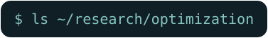
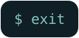

Systems Engineer from Universidad del Valle (Cali, Colombia), working across backend and applied NLP since 2023. All degree requirements completed; conferral expected December 2026. My thesis built a named entity recognition system for Spanish clinical text, and in 2026 I modeled the FIA Formula 1 2026 Technical Regulations with SMT solvers as a research intern at the PReCISE group, Université de Namur.

<table>
<tr>
<td width="50%" valign="top">

### 🏁 [MedAI](https://github.com/Herreran903/medai-backend)
**Undergraduate thesis** · Clinical NER in Spanish

Corpus annotated from scratch, four modeling approaches compared. **0.8767 strict F1** on a held-out test set, dropping to **0.5636** against independent expert annotations — a gap in annotation criteria, reported as the study's main limitation. Served through a FastAPI microservices backend exposing five selectable models, each isolated in its own container.

   

</td>
<td width="50%" valign="top">

### 🤖 [La Sala](https://github.com/Herreran903/la-sala)
**Hackathon** · Shared LLM agent session — **[try it →](https://sesion-agente.vercel.app)**

An agent session a whole team watches live. Every instruction is attributed, conflicting requests open a **vote that halts the agent**, and control passes between drivers without losing context.

  

</td>
</tr>
<tr>
<td width="50%" valign="top">

### ⚙️ [Emazon microservices](https://github.com/Herreran903/api-stock)
**Pragma Power Up** · E-commerce backend

Four REST microservices — users, catalog, cart, checkout — built on hexagonal architecture, with JWT auth and inter-service calls over OpenFeign that propagate the caller's token. **53 unit test classes.**

  

</td>
<td width="50%" valign="top">

### 📊 [Yelp review classification](https://github.com/Herreran903/yelp-review-classification)
**Neural Networks coursework** · Four architectures, one task

MLP, RNN, LSTM and a fine-tuned **RoBERTa** predicting review ratings, each under three treatments of class imbalance. The result worth reading is a negative one: **loss weighting failed to remove majority-class bias in every configuration**, undersampling traded accuracy for fairness, and scale erased the tradeoff. Bayesian search over 30 trials; the full Yelp dump streamed as NDJSON into Parquet shards to fit Colab. Ships with the 37-page report.

  

</td>
</tr>
</table>

The line of work that started with a research internship and kept going.

| | |
|---|---|
| **[JSSP solver](https://github.com/Herreran903/jssp-backend)** · **[visualizer](https://github.com/Herreran903/jssp-visualizer)** | Job Shop Scheduling solved with **MiniZinc** constraint models — tardiness and maintenance variants — exposed through a dockerized FastAPI service, with a TypeScript frontend to explore the schedules. |
| **[Solver selection with CNNs](https://github.com/Herreran903/practica-invg)** | Instances of **SAT** and **JSSP** encoded as images or tensors, then a CNN predicts which solver cracks them inside the time limit. Classification, multilabel and regression pipelines, all YAML-driven. |
| **PReCISE, Université de Namur** | Variability modeling of the **FIA Formula 1 2026 Technical Regulations** in UVL: 1,060 boolean features, 34 cardinalities, 1,212 constraints. Benchmarked Z3 (SMT) against CP-SAT and CBC — Z3 came out an order of magnitude faster. |

<code>$ ls ~/projects --all</code> · more projects & coursework

 

| Project | What it is | Stack |
|---|---|---|
| **[NER model pipelines](https://github.com/Herreran903/ner_pipelines)** | The BiLSTM+CRF baseline behind the thesis: a custom Keras loop over the CRF log-likelihood and a Dice objective for the `O`-tag imbalance. | `TensorFlow` `Keras` |
| **[Spanish clinical NER](https://github.com/Herreran903/spanish-clinical-ner)** | BiLSTM-CRF against BETO and XLM-RoBERTa with LoRA adapters on CodiEsp, ten oncology entity types, macro F1 0.905–0.933. | `Transformers` `PEFT` |
| **[ToolFlow](https://github.com/kev405/toolflow-backend)** | Inventory, loans and inter-site transfers for multi-site workshops. Lead contributor on the Spring Boot backend and the React frontend. | `Spring Boot` `PostgreSQL` `React` |
| **[El Rescate de Hogwarts](https://github.com/Desarrollo-PI/Proyecto-Videojuego-SB)** | 3D adventure game in the browser with physics, spells and real-time multiplayer · [play it](https://proyecto-videojuego-sb.vercel.app) | `Three.js` `Socket.IO` |
| **[fast-etl](https://github.com/Herreran903/fast-etl)** | Dimensional modeling pipeline: date, client, headquarter and messenger dimensions feeding an accumulating-snapshot fact table. | `Python` `Jupyter` |
| **[Proyecto-ADA](https://github.com/Herreran903/Proyecto-ADA)** | Algorithm analysis and design: red-black trees, binary trees and heaps implemented from scratch over a scheduling domain. | `Python` |
| **[TallerAsociacion](https://github.com/Herreran903/TallerAsociacion)** | Association rule mining over prescribed-medication records. | `Python` `Jupyter` |
| **[Simulación Navier-Stokes](https://github.com/Herreran903/Simulacion-Naiver-Stokes)** | Fluid velocity simulation across a medium using finite differences. | `Python` |
| **[IA search](https://github.com/SakyJoestar/IA-Proyecto-1)** | Search algorithms applied to a pathfinding problem — uninformed and heuristic strategies compared. | `Python` |
| **[Proyecto-RGF](https://github.com/Herreran903/Proyecto-RGF)** | Cost management and optimization for sugar cane farms. | `Scala` |
| **[Constraint programming](https://github.com/Herreran903/taller-1-restricciones)** | Modeling exercises in constraint programming — the groundwork for the JSSP solver above. | `MiniZinc` `LaTeX` |
| **miniPy** *(private repo)* | Interpreter for a programming language: lexical and syntactic analysis, data and control structures. Built with two teammates. | `Racket` |

